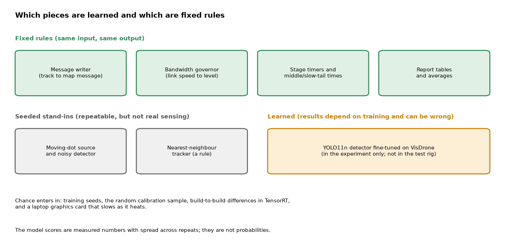
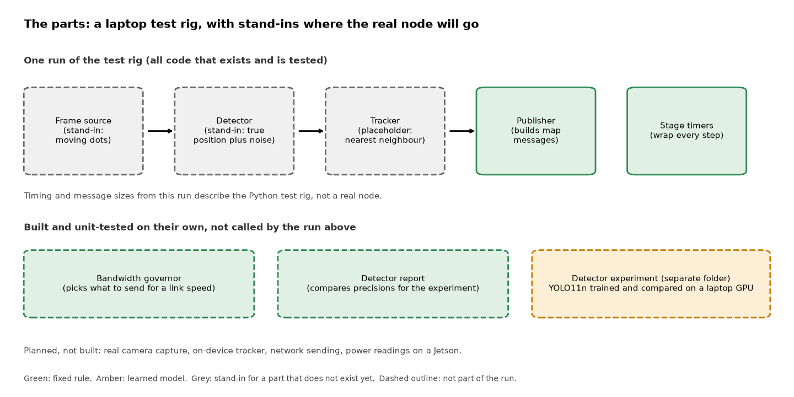
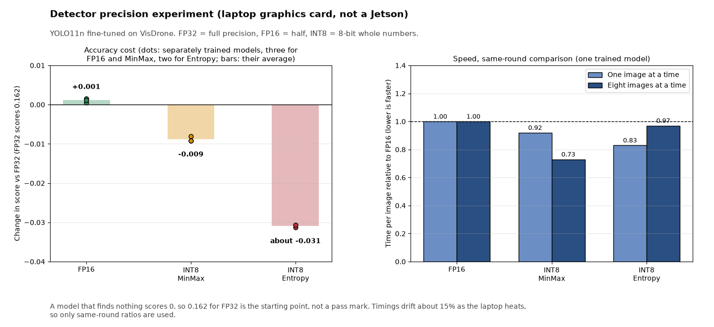

# Sentinel Node

*A starting kit for a small, cheap sensor that would spot people, vehicles and drones on its own and radio back short position messages instead of video; so far a laptop test rig plus one measured experiment on a detection model.*

Status: early scaffold with one measured result, last changed 16 October 2026. Code: https://github.com/PCSchmidt/sentinel-node (public, MIT (Massachusetts Institute of Technology) licence, a permissive open-source licence). It has no stars, no copies made by others and no outside users that I can show. Nothing has run on the intended hardware.

Picture a small battery-powered box on a post at the edge of a field, with a camera, a weak radio link and nobody watching a screen. Sending live video over that link is impossible, so the box has to work out locally what it sees and send only a short note: "something moving at this spot, heading east at 14 metres a second." That is the device this project is working toward. What exists today is a test rig (engineers call it a harness: code that exercises the parts and times them) that runs on a laptop, plus one experiment on the part that would find objects in pictures. The experiment asks how much accuracy a detection model loses when it is shrunk so that it runs faster on small hardware.

Here is what is fixed and what is learned. A calculator always gives the same output for the same input; a weather forecast is a best guess that can be wrong. Nearly everything in the test rig is calculator: the message writer, the rule that decides what to send over a slow link, and the timers. The rig also uses made-up moving dots and a fake detector that is random but repeatable (it uses a "seed", a starting number that makes the same random sequence come out every time), so it is neither calculator nor forecast; it only exercises the code. The one real forecaster is a learned model (software that found patterns in example pictures rather than following written rules) called YOLO11n, the smallest size of the YOLO (You Only Look Once) family of object detectors. It lives in the experiment folder, and nothing in the test rig uses it yet, so no end-to-end detection has been shown.



The key result is narrow. The detector gets a score of 0.162 on a scale from 0 (finds nothing) to 1 (perfect), which is low, though the project does not say how that compares with other models on this data. On a laptop graphics card (a GPU (graphics processing unit), a chip built for heavy number-crunching), storing the model's numbers as INT8 (8-bit whole numbers, only 256 possible values) lowered that score by about 0.009, roughly 5%. It also ran 8% to 27% faster than the same model stored as FP16 (16-bit decimal numbers, half the detail of the original FP32, 32-bit), depending on how many images were processed together. These are not numbers from the small device the box is meant to use, so they indicate what to expect and nothing more. AI coding agents wrote almost all of the code, and I directed the scope, plan, architecture and preferences.

If you have ten minutes, read this opening, then the chapters on what it does, the results, and the one for recruiters and interviewers.

## What problem this solves

A sensor placed out where the action is has little power, a thin radio link and no operator. It cannot stream video, and a person could not watch the feed anyway. It has to decide locally what is there and send only what the link can carry. The README (the front-page text file of a repository) says the interesting question is the trade-off curve: how much accuracy, delay and battery each speed-up costs. That curve, not a demo, is the stated goal. The scope is firm: passive sensing, tracking and reporting only, public data and unclassified scenarios, and no weapons, targeting or engagement functions.

The planned deliverable is a measured table: for each processing step, how long it takes and how much energy it uses at three power settings (7, 15 and 25 watts) on a Jetson Orin Nano (a small NVIDIA computer made for devices like this), plus how much accuracy each shrinking trick costs. Today only the accuracy half exists, and it was measured on a laptop. The device measurements, a real tracker, camera capture and network sending are all listed as planned.

In short, the project exists to measure trade-offs for a tiny sensor, and so far it has measured one of them on a stand-in machine.

## What it does today

I will follow one invented track, "sn-1", through the test rig. A moving object is picked up and followed, and the rig turns it into a short message in CoT (Cursor on Target), a text format that mapping software such as ATAK (Android Team Awareness Kit, a shared map app) can read to show "something is here". In plain words the message says where the object is, which way it is heading (90 degrees, due east) and how fast (14.2 metres a second), with a label and a time stamp. The whole message is 298 bytes, a few lines of text, and a test requires it to stay under 600. A video stream would be vastly larger.

The run goes in four steps. A source hands over frames, each holding the true positions of a few moving dots. A detector reports those positions with a little random error and sometimes misses one. A tracker links each new position to the nearest existing track, or starts a new track, and works out heading and speed from the last two positions. A publisher turns each track into a message and counts the bytes it would send. A timer wraps each step. The source, detector and tracker are stand-ins, placeholders that only exercise the rig, so their timings say nothing about a real node.

Separately, a bandwidth governor (a rule that picks how much detail to send for a given link speed) chooses between tracks plus small thumbnail pictures, tracks alone, tracks at a reduced rate, or nothing. It is built and tested, but the run above does not call it.



An everyday comparison is a lifeguard with a whistle and a clipboard. The lifeguard cannot broadcast a video of the pool, so they note who is where and blow the whistle only when needed. The comparison breaks down because a lifeguard sees well, while this node has no real vision yet.

The user is whoever wants to see the measurement approach, or later build on it. A person types one command and gets a table of timings. Nothing here is a product, and nothing runs unattended.

In short, it turns fake detections into tiny messages and times each step, and a separate rule for slow links exists but is not yet part of the run.

## How it works: parts, data and tools

The parts have one job each: the source supplies frames, the detector finds things, the tracker follows them, the publisher writes messages, the governor picks a sending level and the timers record how long each step takes. The design notes draw the governor between tracker and publisher, but the code does not call it, so the notes show the plan, not what runs.

The test rig uses made-up dots, so there is no real data to clean. The experiment uses VisDrone, a public collection of pictures taken from drones, with boxes drawn around classes that include pedestrians, cars, vans, trucks, buses and motorbikes. A script downloads it (about 2 GB) and it is not stored in the repository. Its licence terms are not stated there. The pictures show aerial people and vehicles, not small drones flying in the air, which is what the sensor is meant to spot; no drone-specific dataset has been chosen.

The tools are few. The test rig uses only Python's standard library and a test runner. The experiment adds PyTorch (a widely used toolkit for neural networks), Ultralytics (the library that publishes the YOLO detectors, used here for training and exporting) and TensorRT (NVIDIA's software that compiles a trained network into a faster version for its own chips). The weak link is the gap between what exists and the target: the real work, on the device, has not begun.

## The methods, and why they were chosen

**Choosing what to send.** The governor works out how many bits per second each level needs, then picks the richest level that fits within 70% of the link's measured capacity, keeping the rest as slack. Toy example from the project's own tests: five tracks, one update a second, 350 bytes each, need 5 × 1 × 350 × 8 = 14,000 bits per second. Dividing by 0.7 gives 20,000, so the tracks level needs a link of at least 20,000 bits per second, and at 19,000 the node drops to the reduced level. The rule also has a memory: it drops at once when the link gets worse, but climbs back only when the link is comfortably better, not merely just enough. A thermostat does the same by waiting a degree before switching back on, so the node does not flap between levels.

**Timing and energy.** Each step is timed, and the rig reports the middle value (called p50) and the slow tail (p95: the time that 95% of runs beat). The tail matters because a node that is usually fast but sometimes stalls misses frames. Energy per frame is average power in watts times time in seconds; toy example: 10 watts for 20 milliseconds is 0.2 joules. No power reader exists yet.

**Shrinking a model.** Quantisation means storing a model's numbers with fewer bits, like measuring a room with a ruler marked in centimetres instead of millimetres: smaller and faster, slightly less exact. Toy example: take 0.12, -0.57 and 0.90 and scale them so the largest becomes 127. They become 17, -80 and 127, and mapped back they read 0.1205, -0.5669 and 0.9000, close but not equal. INT8 also needs calibration: show the model a sample of pictures, watch how big its internal numbers get, and choose the scale from that. "MinMax" calibration uses the largest value seen; "Entropy" calibration ignores rare extremes to fit the common range better. The calibration pictures come from the training set, not from the pictures used for scoring.

**The score.** The score is mAP50-95 (mean Average Precision at overlap thresholds from 50% to 95%), the standard detection score. Each detection is a drawn box, and a box counts as right only if it overlaps the true box enough. The score runs from 0 (finds nothing) to 1 (perfect), and the strict overlap test makes high values hard on tiny aerial objects. Everywhere in this guide I quote it on that 0-to-1 scale.

In short, the useful part is measuring each speed-up together with its cost, in the same units.

## The detection model and what it gets wrong

The one model is YOLO11n, the detector introduced in the opening: a neural network that looks at a whole picture once and returns boxes with labels and confidence scores. The "n" means nano, the smallest size. It takes in a 640 by 640 pixel image and gives back boxes for the VisDrone classes. It started from weights (the numbers the network learned) trained on COCO (Common Objects in Context), a general collection of everyday photos, and was fine-tuned, meaning trained further on VisDrone, for 30 epochs (passes over the training pictures). That took about 52 minutes on the laptop. The repository does not say why this model was chosen, and no comparison with other detectors was run.

Three versions matter: the original, a TensorRT FP16 engine and a TensorRT INT8 engine. An "engine" is TensorRT's word for the compiled version of the network, tied to one graphics chip. The INT8 engine keeps the final confidence step in higher precision, which the experiment's notes say is how the library builds it. Engines do not move between machines, so the Jetson would need new ones.

What it gets wrong: a score of 0.162 means it misses or misplaces many objects. That is plausible for tiny aerial figures, but the repository does not compare it with other published models. It has never been run on small drones, the sensor's stated target, and no safeguard sits around it, because nothing acts on its output. The scores are measured numbers with spread, not probabilities.

## Edge cases, testing and safeguards

The tests are 42 small unit tests, each checking one piece in isolation with exact numbers worked out beforehand: the message writer, the governor, the timers and the placeholder tracker, plus one test that runs the four steps together. All 42 pass in a clean copy. They do not cover the experiment scripts or any real camera data. In the three tests examined, the expected values were worked out by hand, not copied from the code. The project's automatic checks (CI (Continuous Integration), a service that runs the tests on every push to GitHub) are green on every run on file.

Bad input is mostly refused: impossible coordinates, times without a time zone and odd characters are rejected or escaped. Two quirks are worth knowing. A brand-new track reports heading 0 and speed 0, because there is no earlier position to compare, and a link of zero capacity with no tracks still reports the richest level, which is harmless but surprising. Nothing handles a crash, restart or dropped frames, and no network sending exists, so there is nothing to fail yet.

One mild optimism affects every score: the experiment scores on VisDrone's validation pictures, the same ones the training tool uses to pick its best saved version. There is no separate test set and no written success rule before results.

In short, the small parts have tests, while the experiment and everything near real hardware are not.

## Does it work? The results

The experiment fine-tuned the model and compared three versions on the validation pictures. A detector that finds nothing would score 0, so the full-precision FP32 version, the original, is the starting point for comparison, not a pass mark.

| Version | Score (0 to 1) | Change vs FP32 | Time per image | File size |
| --- | --- | --- | --- | --- |
| PyTorch FP32 | 0.162 | starting point | 6.59 ms | 5.2 MB |
| TensorRT FP16 | 0.162 | +0.001 | 1.12 ms | 8.1 MB |
| TensorRT INT8 (MinMax) | 0.152 | -0.009 (about 6% lower) | 1.07 ms | 4.9 MB |

The times are the median of five rounds on a laptop RTX A4500 graphics card, for one image at a time, using TensorRT 10.16 and a random-noise picture so that only the model's own time counts (ms is a thousandth of a second). The FP16 file is larger than the FP32 one, which is surprising, since FP16 stores half the detail. The repository gives no reason, so I will not guess.



How to read it. The six-fold jump from FP32 to TensorRT is not a fair test of shrinking, because the plain PyTorch path is slow for such a small model, so the honest comparison is FP16 against INT8. Repeated over three separately trained models, FP16 changed the score by about +0.001, which is noise, and INT8 MinMax lost about 0.009, consistently. Entropy calibration lost about 0.03, a fifth of the score, in every trained model it was tried on, and the cause was not investigated. Rebuilding an engine from identical inputs moved the score by about 0.001, so smaller differences mean nothing. On speed, comparing in the same round because the laptop slows by about 15% as it heats, INT8 MinMax took 0.92 of FP16's time for one image at a time and 0.73 for eight at a time.

The project also reports a negative result: its first run said INT8 was slower than FP16, and that did not reproduce. The first number was one outlier reading, and the README and commit say so. The numbers in this guide match the saved result files.

In short, on this card INT8 buys a modest speed-up for a small accuracy loss, and none of it is measured on the device.

## Could it be put into real use?

No. On the scale of experiment, works on a laptop, deployable, and operated, the test rig sits at works on a laptop (it runs and passes its tests, but does nothing real) and the detector work sits at experiment. Nothing is hosted and no outside user is known. A real deployment would need the device, a camera, a tracker, network sending, power measurement, monitoring and a security review. Three steps would help most: build the engines on a Jetson and time them with real power readings; wire the governor into the run and add network sending; and put the trained detector into the rig so the timing table has a real detection row. As a showcase it rates "possible", because it measures a trade-off with repeats, not because it is a working system.

## Strengths, shortcomings and the work still to do

The calibration uses training pictures, not scoring pictures, so answers do not leak into the test. Runs are repeated across three training seeds and the spread is reported. The project corrected its own wrong claim in public and kept the first-pass numbers in a saved file, and its README says plainly what has not been done.

Three shortcomings matter most. The detection model is not in the test rig, so no end-to-end result exists. The design notes have drifted: they still call the dataset undecided and draw the governor in the flow. And the message has not been checked in a real mapping app. The roadmap lists the rest as planned, including camera capture, on-device delay and energy, a real tracker and link tests at slow speeds.

## How it was built, and who did what

AI coding agents wrote almost all of the code, as stated at the top. All five commits, made on 16 October 2026, carry an AI co-author credit, and the repository has no instruction files for the agents. The work was checked by tests, the experiment's repeats and an in-repo correction of an early wrong claim. What I decided beyond the scope statement in the README is not written down in the repository.

## For recruiters and interviewers

In thirty seconds: I directed AI coding agents to build a test rig for a small edge sensor and an experiment measuring what shrinking a detection model to 8 bits costs in accuracy and gains in speed, repeated across training runs and reported with its own correction. In two minutes, add that nothing has run on the target hardware and that the model is not yet in the test rig.

| Typical requirement | What the project shows | Strength |
| --- | --- | --- |
| Optimising a model for small hardware | Precision comparison with repeats, on a laptop card | Partly |
| Evaluation and reporting of results | Held-out calibration data, spread, a public correction | Partly |
| Software practice | 42 passing tests, CI on two Python versions | Partly |
| Deploying and operating | Nothing hosted, no device runs | Not shown |

The roles I am aiming at are AI engineer, forward-deployed AI engineer (an engineer placed with a customer) and applied AI or machine-learning engineer. The AI engineer role fits best, as a partial fit, because of the quantisation and measurement work; the forward-deployed role fits least, since nothing was built for a customer. What not to claim: that anything runs on a Jetson, that the rig's timings describe a real node, or that this tracks small drones.

Questions I would expect:

- **How do you know the numbers?** Raw result files and a three-seed repeat are in the repository, and small differences are noise.
- **Have you run this for real users?** No. It has not left the laptop.
- **What is still unsolved?** Real on-device delay and power.
- **What comes next?** Rebuilding the engines on a Jetson and measuring energy per frame.

A five-minute demo: run the rig's command to show the timing table, show one 298-byte message, then the governor tests and the results table, ending with the planned list.

## Where to look in the code

```text
sentinel-node/
  src/sentinel_node/      message writer, governor, timers, run driver, report helpers
  tests/                  the 42 unit tests
  experiments/detector/   training, engine export, comparison and latency scripts, and saved results
  docs/                   design notes and the roadmap
```

The program starts at the command line (`python -m sentinel_node.cli --frames 300`). The experiment needs a graphics card, TensorRT and a 2 GB download.
